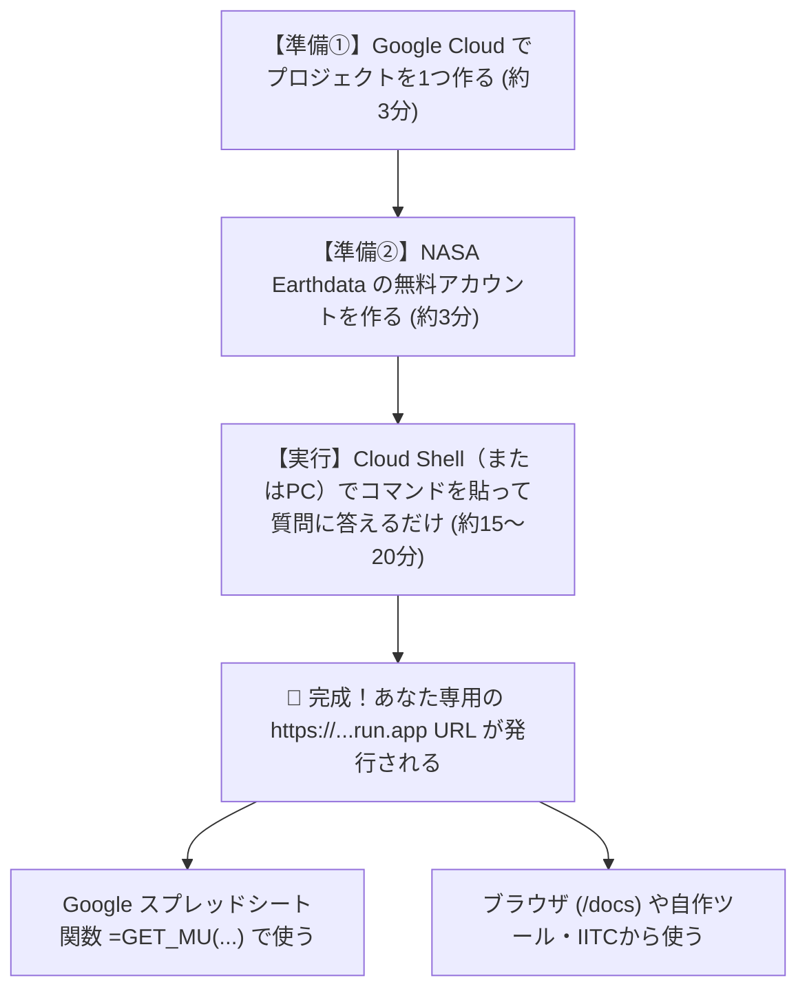

# ゼロから始める Ingress MU Calculator 自分専用APIサーバー構築ガイド（Google Cloud Run 版）

> **📌 本リポジトリについて（参照元・クレジット）**
> 本パッケージは、**[InvestigateXM/Ingress-MU-calculation](https://github.com/InvestigateXM/Ingress-MU-calculation)**（解説サイト: [https://mu.investigatexm.com](https://mu.investigatexm.com)）をベースに、誰でも **Google Cloud Run + Cloud Storage の常時無料枠（月額 0円）** で自分専用の API サーバーを簡単に構築・運用できるよう、**Cloud Run 高速起動ラッパー・対話型全自動デプロイスクリプト・初心者向け日本語手順書** を追加した派生パッケージ（フォーク）です。
> コアとなる MU 計算アルゴリズムおよび検証モデルの詳細は、オリジナルリポジトリおよび [Method 解説ページ](https://mu.investigatexm.com/method.html) をご参照ください。

---

このガイドでは、プログラミングやクラウドの経験がない方でも、**月額 0円（GCPの常時無料枠内）** で自分専用の **全世界対応 Ingress MU 計算 API サーバー** を Google Cloud 上に立ち上げる方法を、アカウント作成から順番に解説します。

> **💡 パソコンへのソフト導入すら不要！**
> Google Cloud のブラウザ画面に付属している無料ターミナル（**Cloud Shell**）を使えば、お使いのパソコン（Windows / Mac / Chromebook / スマホ・タブレット）に一切ソフトをインストールせず、**ブラウザ上のコピペ操作だけ**で最後まで完成します。

---

## 全体の流れ（3ステップ・所要時間 約15〜20分）



---

## 料金と安全性について（なぜ 0円で動くのか？）

Google Cloud には毎月リセットされる **「Always Free（常時無料枠）」** があります。このスクリプトは無料枠に収まる設定でデプロイします。

| リソース | 毎月無料で使える枠 (`us-west1` 等) | 月1万回 MU計算した場合の消費量 | 月額料金 |
| :--- | :--- | :--- | :---: |
| **Cloud Run（計算サーバー）** | 月200万リクエスト / 18万vCPU秒 | 1万リクエスト / 約200秒（無料枠の0.5%以下） | **0 円** |
| **Cloud Storage（データ置場）** | 5 GB まで無料（アカウント合計） | 約 3.2 GB（全世界の人口データ） | **0 円** |

- **アクセスがない時は自動で0台（スリープ）** になり、計算した数ミリ秒〜数秒だけ動く仕組みです。
- 万が一アクセスが集中しても無料枠を超えないよう、スクリプト側で **「最大1台まで（`--max-instances=1`）」** の安全リミッターを自動で設定しています。
- ※東京リージョン（`asia-northeast1`）を選んだ場合のみ、Cloud Storage のデータ保存代として **月額 約12円** かかります（`us-west1` なら 0円です）。

---

## 事前準備①：Google Cloud のアカウントとプロジェクトを作る（約3分）

1. **[Google Cloud コンソール](https://console.cloud.google.com/)** を開き、普段使っている Google アカウントでログインします。
   - 初めて利用する場合は、画面の案内に従って利用規約に同意し、無料トライアル（または請求先アカウント）の登録を行います（本人確認のためクレジットカード等の登録が必要ですが、勝手に課金されることはありません）。
2. 画面左上のロゴの横にある **プロジェクト選択ボタン** をクリックし、右上の **「新しいプロジェクト」** を押します。
   - **プロジェクト名**：わかりやすい名前を入力します（例：`ingress-mu`）
   - 入力欄のすぐ下に **`プロジェクト ID: ingress-mu-123456`** のような英数字が表示されます。**この「プロジェクト ID」を後で使うのでコピーしてメモ**しておきます。
   - **「作成」** ボタンを押します。
3. 画面上部のプロジェクト選択ボタンが、今作ったプロジェクトに切り替わっていることを確認します。

---

## 事前準備②：NASA Earthdata の無料アカウントを作る（約3分）

Ingress の MU 計算には、NASA SEDAC が配布している「GRUMP v1（2000年国連調整済み人口カウントグリッド）」という公式データを使用します。これを自動ダウンロードするために無料のアカウントを作ります。

1. **[NASA Earthdata Login](https://urs.earthdata.nasa.gov/users/new)** を開きます。
2. 以下を入力してアカウントを作成します：
   - **Username**（ユーザー名）と **Password**（パスワード）※あとでスクリプトに入力するのでメモしておきます。
   - 名前、メールアドレス、国（Japan）、Affiliation（`Other` / `Personal` などでOK）を入力し、登録ボタンを押します。
3. 届いた確認メールのリンクを開くか、**[Earthdata トップ](https://urs.earthdata.nasa.gov/)** にログインします。
4. **【重要】データダウンロード権限の承認（30秒）**：
   - ログイン後の画面上部メニューから **「Applications」＞「Authorized Apps」** を開きます。
   - 下の方にある **「Approve More Applications」** ボタンを押します。
   - 検索欄に `SEDAC` または `GESDISC` と入力して検索し、出てきたアプリ（**NASA GESDISC DATA ARCHIVE** など）の **「Authorize」** ボタンを押して承認します。

---

## 本番：コマンド1発でデプロイする（A または B のやりやすい方）

### パターンA：Google Cloud のブラウザ画面（Cloud Shell）だけでやる場合（PCへのソフト導入不要・一番簡単！）

1. **[Google Cloud コンソール](https://console.cloud.google.com/)** の画面右上にある **「`>_`（Cloud Shell をアクティブにする）」アイコン** をクリックします。
2. 画面下部に黒いターミナル画面が開きます（途中で「承認」が出たら「承認」を押します）。
3. **ZIPファイルで受け取った場合**：
   - 黒いターミナル画面の右上にある **「︙（その他）」＞「アップロード」** をクリックし、手元の `ingress-mu-cloudrun-kit.zip` を選んで **「アップロード」** を押します（または黒い画面にZIPファイルを直接ドラッグ＆ドロップします）。
   - 以下のコマンドを貼り付けて **Enter** を押します：
     ```bash
     unzip -o ingress-mu-cloudrun-kit.zip -d ingress-mu
     cd ingress-mu
     bash deploy/cloudrun/deploy.sh
     ```
4. **GitHub リポジトリから直接取得する場合**：
   - 以下のコマンドを貼り付けて **Enter** を押します（URLは公開先のリポジトリURLに置き換えてください）：
     ```bash
     git clone <このリポジトリのURL> ingress-mu
     cd ingress-mu
     bash deploy/cloudrun/deploy.sh
     ```

---

### パターンB：自分のパソコン（Linux / Mac / Windows WSL）でやる場合

このフォルダ内でターミナルを開いて以下を実行します：

```bash
bash deploy/cloudrun/deploy.sh
```

---

## スクリプト実行中に聞かれる4つの質問

`bash deploy/cloudrun/deploy.sh` を実行すると、日本語で順番に以下を聞かれるので、入力して Enter を押すだけです：

1. **`GCP プロジェクト ID`**:
   - 事前準備①で作成したプロジェクトIDが表示されていれば、そのまま **Enter** を押すだけです（空欄なら入力して Enter）。
2. **`デプロイ先のリージョンを選択してください`**:
   - そのまま **Enter**（または `1`）を押すと、完全無料枠の `us-west1`（北米オレゴン）になります。
   - 東京（月約12円）にしたい場合だけ `2` を入力して Enter を押します。
3. **`NASA Earthdata ユーザー名`**:
   - 事前準備②で作った Earthdata の Username を入力して Enter を押します。
4. **`NASA Earthdata パスワード`**:
   - Earthdata の Password を入力して Enter を押します（※セキュリティのため入力中は画面に文字が表示されませんが、そのまま打って Enter を押せば大丈夫です）。

### あとは終わるまで見ているだけでOK！（約15〜20分）
質問に答えると、以下の6ステップがすべて全自動で進みます：
- `[Step 1/6]` Python環境の自動セットアップ
- `[Step 2/6]` NASA から全234カ国のデータを自動ダウンロード＆展開（`Ready: xxx` と順番に表示されます）
- `[Step 3/6]` 高速化のための事前計算テーブルの自動作成（`Density tiles ready: .../24576` と64刻みで進みます）
- `[Step 4/6]` Google Cloud の機能（Cloud Run / Storage）を自動でON
- `[Step 5/6]` Cloud Storage バケットを作ってデータをアップロード＆権限設定
- `[Step 6/6]` Cloud Run サーバーをデプロイして公開

> **💡 Cloud Shell で実行中のワンポイント**
> Cloud Shell はブラウザ画面を20分間まったく触らずに放置すると通信が切れることがあります。5〜10分に1回だけ黒い画面をクリックしておくか、もし途中で切れてしまった場合も **もう一度 `bash deploy/cloudrun/deploy.sh` を打てば終わった箇所の続きから再開** します。

最後に緑色の文字で以下のように表示されたら完成です！🎉

```text
[OK] デプロイがすべて完了しました！！
  あなたの API URL      : https://mu-calculator-xxxxxxxxxx.us-west1.run.app
  Swagger テスト画面    : https://mu-calculator-xxxxxxxxxx.us-west1.run.app/docs
```

---

## 完成後の使い方

### 1. ブラウザで計算してみる
- **`Swagger テスト画面`（`https://あなたのURL.../docs`）**：
  ブラウザで開くと、画面上で座標を入力して直接テストできる API 画面が表示されます（`POST /getMU` ＞ `Try it out` ＞ `Execute`）。
- **URL で直接計算**：
  `https://あなたのURL.../getMU?c=35.658581,139.745433&c=35.710063,139.810700&c=35.689487,139.691706` のように座標を付けて開くと、計算結果の JSON がそのまま返ってきます。

---

### 2. Google スプレッドシートで `=GET_MU(A2, B2, C2)` 関数として使う

作戦シートやポータル一覧表で MU を自動計算したい場合は、以下の手順でスプレッドシートに組み込めます：

1. Google スプレッドシートを開き、メニューの **「拡張機能」＞「Apps Script」** をクリックします。
2. 元から書いてある `function myFunction() {}` を消して、以下のコードを貼り付けます（※1行目の `https://...` をあなたの API URL に書き換えてください）：

```javascript
const MU_API_URL = "https://あなたのURL.us-west1.run.app";

/**
 * 3つのポータル座標からMUを計算します
 * 使い方: =GET_MU("35.658581,139.745433", "35.710063,139.810700", "35.689487,139.691706")
 *         または =GET_MU(A2, B2, C2)
 * @customfunction
 */
function GET_MU(p1, p2, p3) {
  const res = UrlFetchApp.fetch(MU_API_URL + "/getMU", {
    method: "post",
    contentType: "application/json",
    payload: JSON.stringify({ coordinates: [String(p1), String(p2), String(p3)], detail: false }),
    muteHttpExceptions: true
  });
  const data = JSON.parse(res.getContentText());
  if (res.getResponseCode() !== 200) {
    throw new Error(data.error || "API Error");
  }
  return data.mu;
}

/**
 * [MU, 面積(km²), 補正前MU, リージョン補正後MU] を横1行に出力します
 * @customfunction
 */
function GET_MU_DETAIL(p1, p2, p3) {
  const res = UrlFetchApp.fetch(MU_API_URL + "/getMU", {
    method: "post",
    contentType: "application/json",
    payload: JSON.stringify({ coordinates: [String(p1), String(p2), String(p3)], detail: true }),
    muteHttpExceptions: true
  });
  const data = JSON.parse(res.getContentText());
  if (res.getResponseCode() !== 200) {
    throw new Error(data.error || "API Error");
  }
  return [[data.mu, data.area_km2, data.raw_mu, data.regional_total_mu]];
}
```

3. フロッピーアイコン（保存 / `Ctrl + S`）を押して閉じれば、スプレッドシートのセルに `=GET_MU(A2, B2, C2)` と入力するだけで世界中の MU が計算されます！

---

## 困ったとき（よくある質問 ＆ 生成AIへの聞き方）

### Q. プロジェクト作成時に「課金プロジェクトの上限（割り当て上限）に達しました」と出た場合
Google Cloud は1つの請求先アカウントに紐付けられるプロジェクト数（通常3〜5個）に上限があります。過去に作った不要なプロジェクトがある場合は、以下の手順で1秒で枠を空けられます：
1. 左上のメニュー（≡）＞ **「お支払い」** ＞ 左メニューの **「アカウント管理」** を開きます。
2. リンクされたプロジェクト一覧から、使っていない古いプロジェクトの右端にある **「︙」＞「課金を無効にする」** を押します（プロジェクト自体を消したい場合は **[リソースの管理](https://console.cloud.google.com/cloud-resource-manager)** から削除できます）。

### Q. スクリプトの途中でエラーが出た場合（生成AIへの聞き方テンプレート）
もし途中でエラーが出た場合は、ターミナルに表示されたエラー文をそのままコピーして、ChatGPT・Gemini・Claude などの生成AIに以下のように貼り付けて聞いてみてください：

> 「Google Cloud Run に Ingress MU Calculator を `bash deploy/cloudrun/deploy.sh` でデプロイしようとしたら、以下のエラーが出ました。初心者向けに次に打つべきコマンドを教えてください：
> （ここにエラー文を貼り付け）」

---

## 使わなくなって完全に削除したい場合

将来このサーバーが不要になった場合は、以下のコマンドを実行するか、Google Cloud コンソールで作成したプロジェクト自体を削除すれば、データもサーバーも完全に消去されます：

```bash
gcloud run services delete mu-calculator --region="us-west1"
gcloud storage rm -r "gs://mu-calculator-data-$(gcloud config get-value project)"
```

---

## 謝辞・参照元・ライセンス (Credits & License)

### 1. オリジナルプロジェクト（Upstream）
本リポジトリの MU 計算エンジン（`mu_calculator/`）は、**[InvestigateXM/Ingress-MU-calculation](https://github.com/InvestigateXM/Ingress-MU-calculation)** による実装です。
- **Original Repository**: [https://github.com/InvestigateXM/Ingress-MU-calculation](https://github.com/InvestigateXM/Ingress-MU-calculation)
- **Documentation & Interactive Explanation**: [https://mu.investigatexm.com](https://mu.investigatexm.com)
- **Prior Work**: Gordon Ludlow 氏の [Reverse Engineering MU](https://gordonludlow.com/ingress/reverse-engineering-mu/) を基礎として再構築されたものです。
- **Code License**: [Apache License 2.0](LICENSE)（詳細は [NOTICE](NOTICE) を参照）。S2 カバーリングロジックは 2011年当時の Google [s2-geometry-library-java](https://github.com/google/s2-geometry-library-java) の `S2RegionCoverer` および `PriorityQueue` の挙動を再現しています。

### 2. 本フォーク（Cloud Run デプロイキット）での追加・変更点
- `deploy/cloudrun/entrypoint.py`: Cloud Storage FUSE マウント環境向けに、234カ国のヘッダインデックス化（`headers.json`）・`.bil` ラスタの遅延 `memmap`・事前計算テーブルの高速ロードを追加し、コールドスタート時間を約20秒から約0.15秒へ短縮
- `deploy/cloudrun/deploy.sh` / `Dockerfile.cloudrun`: 対話型セットアップ、解凍後のZIP自動削除による省スペース化、Cloud Storage バケットの自動作成・IAM権限付与・Cloud Run へのワンコマンドデプロイ対応

### 3. 人口データ（GRUMP v1）に関する出典・利用規約
本パッケージには人口データそのものは同梱されておらず、デプロイ時に利用者自身の NASA Earthdata アカウントを通じて公式配布元から取得します。人口データの著作権および利用条件はコードライセンス（Apache-2.0）とは別に規定されています（詳細は [NASA collection use constraints](https://cmr.earthdata.nasa.gov/search/concepts/C3540929345-ESDIS.umm_json) を参照）。

> **Citation:**
> Center for International Earth Science Information Network (CIESIN), Columbia University; International Food Policy Research Institute (IFPRI); The World Bank; and Centro Internacional de Agricultura Tropical (CIAT). 2011. *Global Rural-Urban Mapping Project, Version 1 (GRUMPv1): Population Count Grid*. Palisades, NY: NASA Socioeconomic Data and Applications Center (SEDAC). [https://doi.org/10.7927/H4VT1Q1H](https://doi.org/10.7927/H4VT1Q1H).
